  

  
  
  

<h3 align="center">✦ sobre</h3>

  Desenvolvedor de <b>dados e automação</b>. Construo cargas de ETL, data warehouse atualizado de minuto em minuto 
  e robôs que tiram o trabalho repetitivo das equipes, do ERP desktop ao portal web.

  engenharia de dados&nbsp;&nbsp;·&nbsp;&nbsp;ETL e orquestração&nbsp;&nbsp;·&nbsp;&nbsp;data warehouse em SQL Server&nbsp;&nbsp;·&nbsp;&nbsp;RPA web e desktop&nbsp;&nbsp;·&nbsp;&nbsp;relatórios automáticos

<h3 align="center">✦ em destaque</h3>

  

  <a href="https://github.com/EdyVerder/ignis"><b>Ignis</b></a> · plataforma de ETL na web, inspirada no Pentaho PDI e no Apache Hop 
  designer visual · mais de 50 tipos de passo · métricas por passo · jobs · agendamentos · histórico com o erro explicado · hoje web, em breve app + web

<h3 align="center">✦ projetos</h3>

código aberto, dados fictícios, testes em todos

<table align="center">
  <tr>
    <td></td>
    <td></td>
  </tr>
  <tr>
    <td></td>
    <td></td>
  </tr>
  <tr>
    <td></td>
    <td></td>
  </tr>
</table>

<h3 align="center">✦ stack</h3>

  
  
  
  
  
  
   
  
  
  
  
  
  
   
  
  
  
  

<h3 align="center">✦ mapa estelar</h3>

  

cada dia do último ano é uma estrela · quanto mais contribuições, mais brilho · dias seguidos viram constelação · atualizado todo dia

