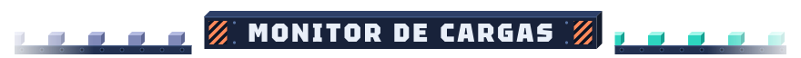

  <picture></picture>

  
  
  <picture></picture>
  <picture></picture>

<picture></picture>

  Desenvolvedor de <b>dados e automação</b>. Construo cargas de ETL, data warehouse atualizado de minuto em minuto 
  e robôs que tiram o trabalho repetitivo das equipes, do ERP desktop ao portal web.

  engenharia de dados&nbsp;&nbsp;·&nbsp;&nbsp;ETL e orquestração&nbsp;&nbsp;·&nbsp;&nbsp;data warehouse em SQL Server&nbsp;&nbsp;·&nbsp;&nbsp;RPA web e desktop&nbsp;&nbsp;·&nbsp;&nbsp;relatórios automáticos

<picture></picture>

  

  <a href="https://github.com/EdyVerder/ignis"><b>Ignis</b></a> · plataforma de ETL na web, inspirada no Pentaho PDI e no Apache Hop 
  designer visual · mais de 50 tipos de passo · métricas por passo · jobs · agendamentos · histórico com o erro explicado · hoje web, em breve app + web

<picture></picture>

código aberto, dados fictícios, testes em todos · clique no cartão para abrir o projeto

  
  
  
  
  
  

<picture></picture>

  <picture></picture>

<picture></picture>

  <picture></picture>

cada dia do último ano é uma caixa · quanto mais contribuições, mais acesa · atualizado todo dia pelo GitHub Actions

